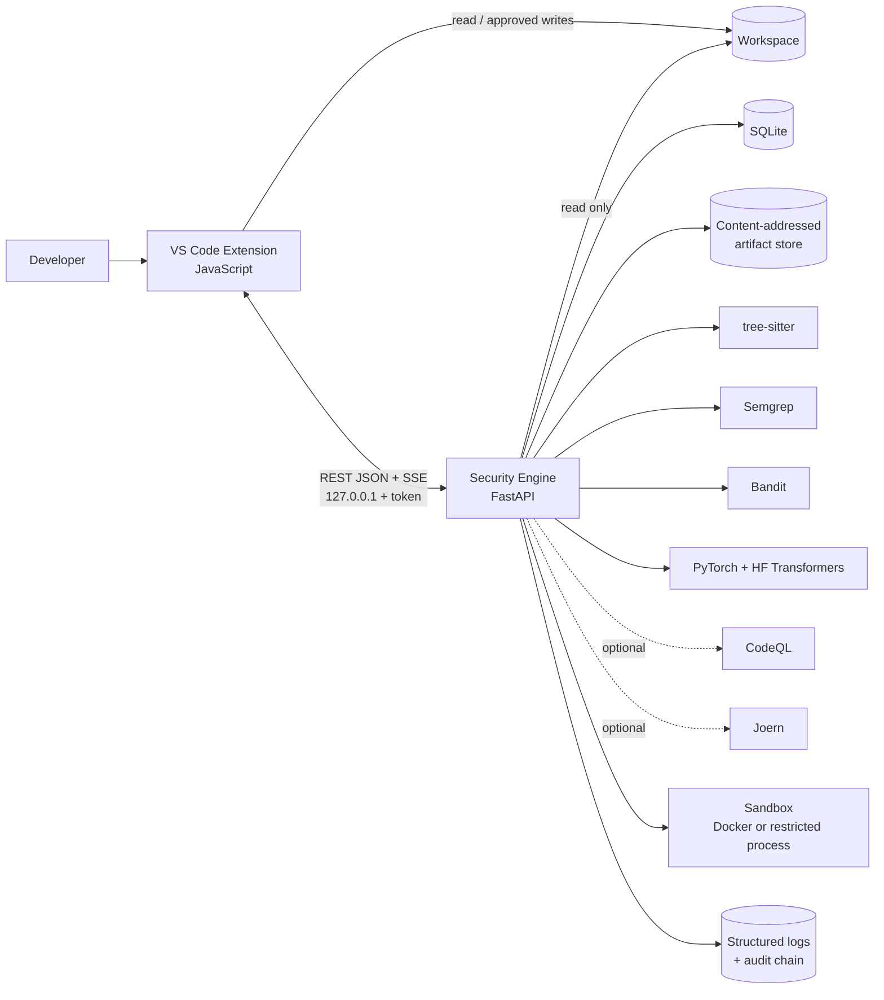
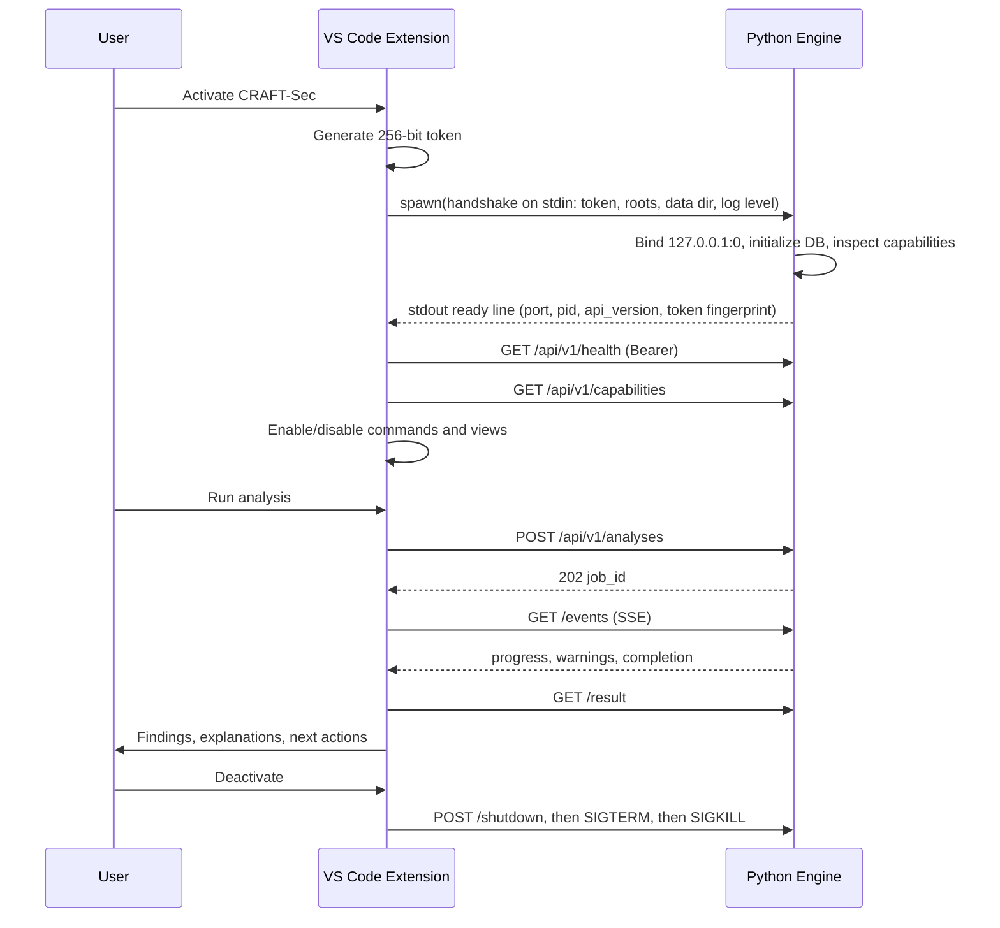
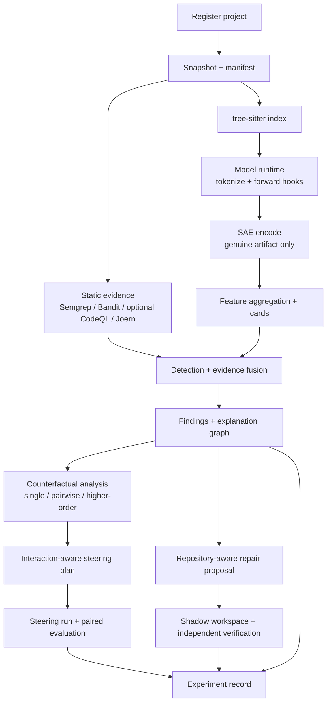
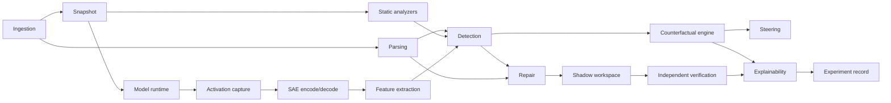

# CRAFT-Sec — Software Architecture

**Status:** Phase 0 architecture approved for implementation. The Phase 1 scaffold, development environment, VS Code extension activation shell, command registration layer, editor-area security dashboard, and backend-result diagnostics layer exist. The dashboard renders only supplied state plus an explicitly labeled demo preview; diagnostics, hover explanations, and repair Quick Fixes are generated only from validated backend scan results. No analysis functionality is implemented.
**Version:** 0.1.0
**Date:** 2026-11-11
**Companion document:** [research-alignment.md](research-alignment.md)

CRAFT-Sec (*Counterfactual Risk Analysis and Feature-aware Steering for Secure Code Generation*) is a local-first system composed of a JavaScript VS Code extension and a Python/FastAPI research engine. It detects vulnerability-relevant evidence, explains it with model-internal and static features, estimates counterfactual feature effects, applies interaction-aware activation steering where the model permits it, proposes repository-aware repairs, and verifies those repairs independently.

This document defines the architecture only. It does not claim that any research component is implemented, validated, or empirically effective.

---

## 1. Purpose and scope

The architecture must make the following possible without compromising research integrity:

1. Ingest a repository and build a reproducible snapshot.
2. Extract static security evidence (tree-sitter, Semgrep, Bandit, optional CodeQL/Joern).
3. Extract genuine SAE features from models whose internal activations are accessible.
4. Detect vulnerability-relevant patterns and attach evidence and uncertainty.
5. Run single-feature, pairwise, and higher-order counterfactual analyses against a defined target metric.
6. Derive and evaluate interaction-aware activation-steering plans.
7. Generate repository-aware repair patches and verify them independently.
8. Record every experiment with enough configuration and provenance to reproduce it.
9. Degrade explicitly — never simulate — when a required capability is unavailable.

**Non-goals for the initial implementation:**

- Hosted multi-tenant operation or remote code-execution services.
- Training SAEs from scratch as a prerequisite (optional later; artifact registration comes first).
- Executing generated or repository code on the host by default.
- Claiming calibrated probabilities, causal effects, or general security guarantees without the specific evidence each requires.
- Supporting every language, analyzer, or model on day one.

---

## 2. Architecture invariants

These are enforced in code, not merely documented.

| ID | Invariant | Enforcement point |
|----|-----------|-------------------|
| I1 | **Capability honesty.** A missing SAE, model, analyzer, or sandbox is reported as unavailable. It is never emulated. | `/api/v1/capabilities`; stage scheduler; UI feature gates |
| I2 | **Evidence provenance.** Every finding, effect, patch, and verdict references producer, version, input snapshot, and artifact hash. | Schemas require `provenance`; artifact store is content-addressed |
| I3 | **Score semantics.** Every score carries `score_kind` (`heuristic`, `model_logit`, `calibrated`). Only `calibrated` may be described as a probability. | Pydantic validators; UI renderers; report generator |
| I4 | **Interventional scope.** Counterfactual results describe model behaviour under named interventions, not real-world causal effects. | Result schemas include `scope: model_intervention`; mandatory wording in UI |
| I5 | **Non-destructive repair.** The Python engine never writes user source. The extension applies patches only after explicit approval and hash revalidation. | Workspace root allowlist; extension-only patch applier |
| I6 | **Execution isolation.** Code is executed only in a declared sandbox. If no adequate sandbox exists, execution is not attempted and the verdict is downgraded. | `SandboxBackend`; verification policy |
| I7 | **Reproducibility.** Research outputs record model revision, SAE hash, analyzer versions, seeds, config hash, and environment. | `RunManifest`; experiment recorder |
| I8 | **Verification independence.** The verifier consumes the patch and snapshot, not the generator's rationale or confidence. | Separate job, separate module, separate run record |
| I9 | **Least privilege.** The backend binds loopback only, requires a per-launch token, and reads only registered workspace roots. | Handshake, middleware, path guard |
| I10 | **Documented limitations.** Each research component ships unit tests and a limitations entry before its capability is enabled. | Capability registry gate; release checklist |

---

## 3. System context



The extension is the only component that writes to the user's workspace. The engine reads registered workspace roots, writes only to its own data directory, and runs verification against a shadow copy.

---

## 4. Monorepo layout

```text
CRAFT-Sec/
├── README.md
├── docs/
│   ├── README.md
│   ├── architecture.md
│   ├── research-alignment.md
│   └── adr/
├── vscode-extension/
│   ├── package.json                 # commands, views, settings, activation
│   ├── src/
│   │   ├── extension.js             # thin activation entry point
│   │   ├── config.js                # settings + SecretStorage bridge
│   │   ├── constants.js             # command, container, and view IDs
│   │   ├── backend/
│   │   │   ├── manager.js           # spawn, handshake, health, restart
│   │   │   └── handshake.js         # token + workspace roots over stdin/stdout
│   │   ├── api/
│   │   │   ├── securityEngineService.js # command-facing engine contract
│   │   │   ├── client.js            # authenticated fetch, retries, cancellation
│   │   │   ├── sse.js               # streaming event parser with resume
│   │   │   └── validate.js          # Ajv validators compiled from shared schemas
│   │   ├── jobs/controller.js       # job lifecycle, progress, result routing
│   │   ├── commands/
│   │   │   ├── index.js             # registration, drift check, composite return
│   │   │   ├── definitions.js       # canonical command metadata
│   │   │   ├── registry.js          # duplicate-safe registration and disposal
│   │   │   ├── validation.js        # editor/workspace/file/selection guards
│   │   │   ├── runEngineCommand.js  # progress, cancellation, error reporting
│   │   │   ├── registerEngineCommand.js
│   │   │   ├── scanCommands.js
│   │   │   ├── analysisCommands.js
│   │   │   ├── repairCommands.js
│   │   │   ├── dashboardCommand.js
│   │   │   └── utilityCommands.js
│   │   ├── views/
│   │   │   ├── findingsTree.js
│   │   │   ├── jobsTree.js
│   │   │   └── statusBar.js
│   │   ├── diagnostics/
│   │   │   ├── findingModel.js      # backend finding validation + severity/CWE
│   │   │   ├── diagnosticController.js # collection, finding store, scope clearing
│   │   │   ├── hoverProvider.js     # explain findings from backend fields
│   │   │   ├── codeActionProvider.js # repair Quick Fix for eligible findings
│   │   │   └── index.js             # provider registration + disposal
│   │   ├── webviews/
│   │   │   ├── dashboardPanel.js    # singleton dashboard panel + message allowlist
│   │   │   ├── dashboardModel.js    # 11 sections, actions, empty/demo state
│   │   │   ├── dashboardHtml.js     # accessible shell + nonce CSP
│   │   │   ├── sidebarView.js       # Activity Bar launcher provider
│   │   │   ├── sidebarHtml.js       # launcher markup
│   │   │   ├── csp.js               # nonce + CSP helpers
│   │   │   ├── html.js              # escaping + safe JSON serialization
│   │   │   └── panelHost.js         # future shared feature-panel host
│   │   ├── workspace/
│   │   │   ├── snapshot.js          # file hashing and change detection
│   │   │   └── patchApplier.js      # approval + hash check + WorkspaceEdit
│   │   ├── logging/output.js        # OutputChannel + log forwarding
│   │   └── security/
│   │       ├── webview.js           # CSP helpers
│   │       └── paths.js             # workspace containment checks
│   ├── media/                       # HTML/CSS/vanilla JavaScript
│   └── test/                        # @vscode/test-electron suites
├── security-engine/
│   ├── pyproject.toml
│   ├── migrations/                  # Alembic revisions
│   ├── src/craftsec/
│   │   ├── __main__.py
│   │   ├── server.py                # app factory, lifespan, middleware
│   │   ├── api/
│   │   │   ├── routes_system.py
│   │   │   ├── routes_projects.py
│   │   │   ├── routes_jobs.py
│   │   │   ├── routes_analysis.py
│   │   │   ├── routes_features.py
│   │   │   ├── routes_counterfactual.py
│   │   │   ├── routes_steering.py
│   │   │   ├── routes_repairs.py
│   │   │   ├── routes_verification.py
│   │   │   └── routes_experiments.py
│   │   ├── core/
│   │   │   ├── errors.py            # exception taxonomy + problem details
│   │   │   ├── auth.py              # bearer token, host validation
│   │   │   ├── paths.py             # canonical root allowlist
│   │   │   ├── cancellation.py
│   │   │   └── jobs.py              # queue, state machine, events
│   │   ├── contracts/               # generated Pydantic models
│   │   ├── db/
│   │   │   ├── models.py
│   │   │   ├── repositories.py
│   │   │   └── session.py
│   │   ├── artifacts/store.py       # sha256 layout, atomic writes, retention
│   │   ├── ingestion/
│   │   │   ├── snapshot.py
│   │   │   └── ignore.py
│   │   ├── parsing/
│   │   │   ├── treesitter.py
│   │   │   ├── symbols.py
│   │   │   └── languages.py
│   │   ├── program_analysis/        # repository-level call graph/taint/reachability
│   │   │   ├── callgraph.py
│   │   │   └── taint.py
│   │   ├── static/
│   │   │   ├── semgrep.py
│   │   │   ├── bandit.py
│   │   │   ├── codeql.py            # optional adapter
│   │   │   ├── joern.py             # optional adapter
│   │   │   └── normalize.py         # SARIF/JSON -> FindingEvidence
│   │   ├── models/
│   │   │   ├── runtime.py           # load, forward, hooks, generate
│   │   │   ├── registry.py
│   │   │   └── token_alignment.py
│   │   ├── sae/
│   │   │   ├── registry.py          # artifact manifests + compatibility
│   │   │   ├── loader.py            # safetensors only
│   │   │   ├── sae.py               # encode/decode/direction
│   │   │   └── cards.py             # feature cards and labelling provenance
│   │   ├── features/extractor.py
│   │   ├── detection/
│   │   │   ├── detector.py
│   │   │   ├── fusion.py
│   │   │   └── calibration.py       # only with real held-out labels
│   │   ├── evaluation/
│   │   │   ├── metrics.py
│   │   │   └── statistics.py
│   │   ├── counterfactual/
│   │   │   ├── interventions.py
│   │   │   ├── engine.py            # single / pairwise / higher-order
│   │   │   ├── shapley.py           # sampling estimator + CIs
│   │   │   ├── flip_search.py       # minimal flipping set (local minimality)
│   │   │   └── validity.py          # drift + faithfulness checks
│   │   ├── steering/
│   │   │   ├── planner.py           # interaction-aware feature selection
│   │   │   ├── steerer.py           # decoder-direction hooks + clipping
│   │   │   └── evaluate.py          # paired security/functional evaluation
│   │   ├── repair/
│   │   │   ├── context.py           # repo-aware context assembly
│   │   │   ├── generator.py
│   │   │   ├── patch.py             # unified diff + schema validation
│   │   │   └── shadow.py            # shadow workspace management
│   │   ├── verification/
│   │   │   ├── verifier.py          # independent orchestration
│   │   │   ├── security_check.py
│   │   │   ├── functional_check.py
│   │   │   └── policy.py
│   │   ├── explain/graph.py         # evidence graph assembly
│   │   ├── experiments/
│   │   │   ├── manifest.py
│   │   │   ├── recorder.py
│   │   │   └── export.py
│   │   ├── observability/
│   │   │   ├── logging.py
│   │   │   ├── redaction.py
│   │   │   └── audit.py
│   │   └── sandbox/
│   │       ├── base.py
│   │       ├── docker.py
│   │       └── process.py           # restricted; limited verification only
│   ├── tests/
│   │   ├── unit/
│   │   ├── integration/
│   │   ├── contract/
│   │   └── fixtures/
│   └── LIMITATIONS.md
├── shared/
│   ├── schemas/                     # JSON Schema source of truth
│   ├── generated/                   # generated validators / models (checked in)
│   └── fixtures/                    # valid + invalid payload examples
├── research/
│   ├── configs/                     # versioned experiment configurations
│   ├── datasets/                    # dataset cards only; no data blobs
│   ├── evaluation/                  # metrics, statistics, protocols
│   ├── experiments/                 # generated run records (gitignored)
│   └── protocols/                   # preregistration and study protocols
├── benchmarks/
│   ├── configs/                     # pinned benchmark configurations
│   ├── datasets/                    # dataset cards only
│   ├── harness/                     # runner and scoring adapters
│   ├── tasks/                       # task definitions
│   └── results/                     # generated results (gitignored)
├── scripts/                         # structure check, codegen, schema drift
└── .github/workflows/               # lint, test, contract, package
```

No TypeScript is used. Extension code is JavaScript with JSDoc annotations. Webviews use vanilla JavaScript, HTML, and CSS; no frontend framework is used.

---

## 5. Module responsibilities

### 5.1 VS Code extension

| Module | Responsibilities | Must not |
|--------|------------------|----------|
| `src/extension.js` | Activate/deactivate, construct services, register disposables, enforce single instance | Contain analysis logic |
| `config.js` | Read settings, validate combinations, bridge secrets from `SecretStorage` to child env | Persist secrets in settings or logs |
| `backend/manager.js` | Locate Python, spawn `python -m craftsec`, pass handshake via stdin, capture stdout/stderr, health poll, restart with backoff, terminate process group | Bind a fixed public port; ignore crash loops |
| `api/client.js` | Bearer-authenticated fetch, timeouts, bounded retries for idempotent calls, cancellation | Retry non-idempotent mutations blindly |
| `api/sse.js` | Parse SSE over `fetch` streaming, resume with `Last-Event-ID`, heartbeat timeout | Use `EventSource` (cannot send auth headers) |
| `api/validate.js` | Ajv validation of every request body and response payload against shared schemas | Accept unvalidated JSON |
| `jobs/controller.js` | Track job state, route progress to views, persist last event id, surface warnings/errors | Treat `partial` as success |
| `api/securityEngineService.js` | Define the command-facing engine contract; the unavailable implementation rejects with a typed `E_ENGINE_UNAVAILABLE` error | Invent analysis results or success responses |
| `commands/index.js` | Register every declared command, verify the complete set, and return one composite disposable | Leave partial registrations after an error |
| `commands/registry.js` | Own command registrations, reject duplicates, and dispose everything in reverse order | Register the same command twice |
| `commands/validation.js` | Check saved `file:` editors, workspace containment, and selections; build request context | Analyze unsaved buffers or files outside the workspace |
| `commands/runEngineCommand.js` | Show cancellable progress, handle cancellation, and log/report failures | Show a placeholder success notification |
| `commands/scanCommands.js` | Register file, selection, and workspace scan commands; publish successful results to diagnostics with the scanned scope | Bypass editor/workspace validation or publish failed scans |
| `commands/analysisCommands.js` | Register explanation, security-feature, and counterfactual commands | Fabricate features or counterfactual effects |
| `commands/repairCommands.js` | Register generation, repair, and verification commands; accept validated finding context from a Quick Fix | Write code to the workspace, repair a different file, or claim verification |
| `commands/dashboardCommand.js` | Open or reveal the editor-area dashboard panel | Treat opening the dashboard as analysis success |
| `commands/utilityCommands.js` | Report real extension/engine status and open the output channel | Claim the engine is available |
| `views/*` | Findings tree, job tree, status bar; map backend resources to VS Code items | Recompute scores locally |
| `webviews/dashboardPanel.js` | Own the singleton dashboard panel, local-resource roots, per-render nonce CSP, validated messages, allowlisted command execution, refresh, and disposal | Execute arbitrary command IDs or arguments, write files, or apply patches |
| `webviews/dashboardModel.js` | Define the 11-section navigation, action metadata, empty state, explicitly labeled demo state, and unavailable capability schemas | Invent findings, features, probabilities, causal effects, repairs, or verification results |
| `webviews/dashboardHtml.js` | Render the accessible shell, escaped inline state JSON, and local stylesheet/script references | Use inline executable code, remote content, or unescaped state |
| `webviews/sidebarView.js` | Resolve the Activity Bar launcher, validate its single `openDashboard` message, and open the panel | Expose analysis data or execute commands from the sidebar |
| `webviews/sidebarHtml.js` | Render launcher markup with a nonce CSP and local assets | Load scripts other than the launcher |
| `webviews/csp.js`, `webviews/html.js` | Generate nonces/CSP and escape attributes, text, and inline JSON | Allow `'unsafe-inline'`, remote origins, or unescaped interpolation |
| `webviews/panelHost.js` (future) | Shared host for feature-specific panels with strict CSP + nonce and message routing | Load remote scripts or allow inline script |
| `webviews/*` (future) | Feature explorer, counterfactual matrix, steering lab, repair review; render only backend-provided claims + provenance | Invent labels, probabilities, or causal wording |
| `workspace/snapshot.js` | Compute relative paths and hashes for change detection before requests | Follow symlinks outside the workspace |
| `workspace/patchApplier.js` | Show diff, require explicit approval, revalidate base hashes, apply via `WorkspaceEdit`, create backup metadata | Write when hashes are stale; apply without approval |
| `diagnostics/findingModel.js` | Validate the backend finding contract; normalize severity, CWE, file URI, range, evidence, references, and explicit repair eligibility | Accept unvalidated JSON or infer missing findings, scores, or repairs |
| `diagnostics/diagnosticController.js` | Own the `DiagnosticCollection` and finding store; publish backend findings, map severity, attach CWE target, evidence, and source related information; clear scan scopes | Publish malformed or out-of-workspace findings; invent diagnostics |
| `diagnostics/hoverProvider.js` | Render backend explanation, evidence, source references, and repair state in a non-trusted Markdown hover | Generate or embellish explanations |
| `diagnostics/codeActionProvider.js` | Offer a Quick Fix only for backend-eligible findings and invoke the repair command with finding context | Edit source, infer eligibility, or apply patches |
| `diagnostics/index.js` | Register the collection, hover provider, and code-action provider as one disposable | Leave providers or collections registered after disposal |
| `security/paths.js` | Normalize and verify workspace containment for backend-supplied paths | Trust backend-supplied absolute paths |
| `logging/output.js` | Mirror extension + backend logs into an OutputChannel with redaction | Log tokens or full source by default |
| `security/webview.js` (future) | Consolidate nonce, CSP, and message-origin helpers for feature panels | Use `'unsafe-inline'` or remote origins |

### 5.2 Security engine

| Module | Responsibilities | Must not |
|--------|------------------|----------|
| `server.py` | App factory, lifespan, auth middleware, request IDs, size limits, OpenAPI gating | Start without a handshake token |
| `api/*` | Thin HTTP adapters: validate, authorize, enqueue, return typed results | Contain analysis logic |
| `core/jobs.py` | Job queue, state machine, cancellation tokens, SSE event log, idempotency | Run GPU work concurrently beyond configured limit |
| `core/errors.py` | Typed exceptions → RFC 9457 problem details | Leak stack traces or secrets to clients |
| `core/paths.py` | Root allowlist, realpath containment, symlink policy | Accept arbitrary filesystem paths |
| `db/*` | SQLAlchemy 2.0 models, repositories, migrations, WAL configuration | Store large tensors as SQLite blobs |
| `artifacts/store.py` | Content-addressed storage, atomic temp→rename, checksums, retention/GC | Serve raw paths to clients |
| `ingestion/snapshot.py` | Manifest of path, hash, size, mode; ignore rules; caps | Read outside roots; follow escaping symlinks |
| `parsing/*` | tree-sitter parse, symbol table, imports, call sites, test detection, parse diagnostics | Claim full coverage when parsing fails |
| `program_analysis/*` | Repository-level call graphs, taint/reachability, and interprocedural context built on parsing/static evidence | Claim precision beyond supported languages or dataflow capabilities |
| `static/*` | Run analyzers, parse SARIF/JSON, normalize to evidence, capture versions/rule hashes | Invent findings or silently drop analyzer errors |
| `models/runtime.py` | Load HF models locally, forward hooks, activation capture, generation, unload | Enable `trust_remote_code` by default |
| `models/token_alignment.py` | Map token offsets to source spans | Guess alignment when offsets are unavailable; mark `unaligned` instead |
| `sae/registry.py` | Artifact manifests, compatibility checks, checksums, license/status | Accept layer/model mismatches |
| `sae/loader.py` | Load `safetensors`, validate shapes/dtypes | Use `torch.load` on untrusted artifacts |
| `sae/sae.py` | Encode/decode, feature directions, sparsity stats | Fabricate activations |
| `sae/cards.py` | Feature cards, top activations, label + `label_source`, confidence | Present auto-interp labels as ground truth |
| `features/extractor.py` | Batch activations → SAE features → span/file aggregation | Emit features when SAE is incompatible |
| `detection/*` | Evidence fusion, score semantics, optional calibration, findings | Label heuristic output as probability |
| `evaluation/*` | Metrics, statistical tests, calibration helpers, and benchmark scoring | Publish metrics without a run manifest or fabricate values |
| `counterfactual/*` | Interventions, effect estimation, interactions, Shapley sampling, flip search, validity | Present model-internal effects as real-world causality |
| `steering/*` | Plan from interactions, decoder-direction steering, guardrails, paired evaluation | Steer API-only or incompatible models |
| `repair/*` | Context assembly, patch generation, diff validation, shadow workspace | Write user source; touch out-of-scope files |
| `verification/*` | Independent security + functional checks, baseline comparison, verdicts | Read generator rationale; claim absolute security |
| `explain/graph.py` | Evidence graph with claim kinds and provenance | Merge evidence classes without labels |
| `experiments/*` | Run manifests, config hashing, experiment grouping, export bundles | Fabricate runs or omit negative results |
| `observability/*` | Structured logs, redaction, hash-chained audit log | Log source code, tokens, or secrets by default |
| `sandbox/*` | Docker and restricted-process execution, resource limits, network policy | Silently fall back to host execution |

### 5.3 Shared contract layer

`shared/schemas/` is the single source of truth for every cross-process payload. Python Pydantic models are generated from JSON Schema; the extension compiles Ajv validators from the same files. Generated artifacts are checked in and verified by a CI drift test. Schema changes require a contract version bump and migration notes.

Core schemas:

| Schema | Purpose |
|--------|---------|
| `common.json` | IDs, timestamps, provenance, claim kind, pagination |
| `error.json` | Problem-details envelope and error codes |
| `capabilities.json` | Available models, SAEs, analyzers, sandbox backends, feature flags |
| `project.json` | Project registration, snapshot, file manifest summary |
| `job.json` | Job request/state/result envelope |
| `events.json` | SSE event payloads |
| `finding.json` | Findings, locations, severity, score semantics, evidence refs |
| `feature.json` | SAE artifact cards, feature cards, feature runs |
| `counterfactual.json` | Interventions, effects, interactions, validity, budgets |
| `steering.json` | Plans, guardrails, paired evaluation results |
| `repair.json` | Patch proposal, per-file hashes, diff, approval state |
| `verification.json` | Profiles, checks, verdicts, artifacts |
| `experiment.json` | Run manifest, config, dataset/artifact references, export |

---

## 6. Runtime and process model

### 6.1 Lifecycle



### 6.2 Handshake details

- The extension generates a 256-bit random token per launch and writes a single JSON line to the child's stdin: `{token, workspace_roots, data_dir, log_dir, log_level, dev_mode}`.
- The backend binds `127.0.0.1` on an ephemeral port, then prints one JSON line to stdout: `{event:"ready", port, pid, api_version, token_fingerprint}`.
- The token is never placed in argv, environment, logs, or URLs. `token_fingerprint` is a truncated SHA-256 for handshake diagnostics only.
- The backend watches stdin. If the extension dies and stdin closes, the backend shuts down, preventing orphan processes.
- All API routes require `Authorization: Bearer <token>`; the extension validates the `Host` header against loopback values and sends no `Origin` header. CORS is disabled.

### 6.3 Failure and restart policy

| Condition | Behaviour |
|-----------|-----------|
| Handshake timeout (15 s) | Kill child, show actionable error, offer retry |
| Health failure after ready | Restart up to 3 times with exponential backoff (1, 4, 15 s) |
| Crash loop (>3 failures / 5 min) | Stop auto-restart; require user action; preserve logs |
| Contract major mismatch | Refuse connection; instruct user to update matching versions |
| Backend exits during job | Job marked `interrupted`; partial artifacts retained; no silent resume |

### 6.4 Concurrency model

- FastAPI async I/O for HTTP; CPU/GPU work runs in a bounded worker pool or dedicated process, never blocking the event loop.
- GPU jobs are serialized by default (`GPU_CONCURRENCY=1`); CPU analysis jobs have a configurable small pool.
- One SQLite writer at a time, serialized through a write queue; WAL mode and `busy_timeout` for readers.
- A job may request cancellation; stages check a cancellation token between files, batches, and model evaluations.

---

## 7. Communication contract

### 7.1 Principles

1. JSON over HTTP; no pickle, no ad-hoc form encodings.
2. Every request and response validates against a shared schema before use.
3. Long-running work is an asynchronous job. Synchronous endpoints are limited to metadata and small reads.
4. Large payloads never travel in JSON. The API returns artifact references plus compact summaries; the extension requests only what it renders.
5. Source code is referenced by project + relative path, not re-uploaded per request. The backend reads from registered roots.
6. Versioning is explicit: `/api/v1`, `contract_version`, and a major/minor compatibility check at startup.

### 7.2 Endpoint surface (initial contract)

| Method | Path | Purpose | Mode |
|--------|------|---------|------|
| GET | `/api/v1/health` | Liveness, uptime, DB status | Sync |
| GET | `/api/v1/version` | Build, Python, contract versions | Sync |
| GET | `/api/v1/capabilities` | Models, SAEs, analyzers, sandbox, feature gates | Sync |
| GET | `/api/v1/config/effective` | Redacted effective config + config hash | Sync |
| POST | `/api/v1/shutdown` | Graceful shutdown from the owning extension | Sync |
| POST | `/api/v1/projects` | Register a workspace root (must be allowlisted) | Sync |
| GET | `/api/v1/projects` | List projects | Sync |
| POST | `/api/v1/projects/{id}/snapshots` | Build file-hash snapshot | Sync (bounded) |
| POST | `/api/v1/projects/{id}/index` | tree-sitter index | Job |
| POST | `/api/v1/analyses` | Static + model-evidence analysis | Job |
| GET | `/api/v1/analyses/{id}` | Analysis summary | Sync |
| GET | `/api/v1/analyses/{id}/findings` | Paginated findings | Sync |
| GET | `/api/v1/findings/{id}` | Finding detail | Sync |
| GET | `/api/v1/findings/{id}/explanation` | Evidence graph | Sync |
| GET | `/api/v1/sae/artifacts` | Registered SAE cards | Sync |
| POST | `/api/v1/sae/artifacts` | Register local artifact + manifest | Sync |
| POST | `/api/v1/features/extract` | Activation + SAE feature extraction | Job |
| GET | `/api/v1/features/runs/{id}` | Feature run summary | Sync |
| GET | `/api/v1/features/{feature_id}` | Feature card | Sync |
| POST | `/api/v1/counterfactuals` | Single/pairwise/higher-order run | Job |
| GET | `/api/v1/counterfactuals/{id}` | Effects + validity + budget | Sync |
| POST | `/api/v1/steering/runs` | Plan + generate + paired evaluation | Job |
| GET | `/api/v1/steering/runs/{id}` | Plan, guardrails, evaluation | Sync |
| POST | `/api/v1/repairs` | Repository-aware patch proposal | Job |
| GET | `/api/v1/repairs/{id}` | Patch metadata + diff ref | Sync |
| POST | `/api/v1/repairs/{id}/verify` | Shadow apply + independent verification | Job |
| GET | `/api/v1/verifications/{id}` | Security/functional verdicts | Sync |
| GET | `/api/v1/jobs/{id}` | Job state, warnings, stage summary | Sync |
| GET | `/api/v1/jobs/{id}/result` | Typed result or artifact references | Sync |
| POST | `/api/v1/jobs/{id}/cancel` | Cooperative cancellation | Sync |
| GET | `/api/v1/jobs/{id}/events` | SSE progress stream | Stream |
| GET | `/api/v1/experiments` | List experiments | Sync |
| POST | `/api/v1/experiments/{id}/export` | Reproducibility bundle | Job |
| GET | `/api/v1/artifacts/{id}/summary` | Small JSON summary of an artifact | Sync |

`POST /api/v1/repairs/{id}/apply` deliberately does **not** exist. Patch application belongs to the extension.

### 7.3 Job protocol

```text
POST /api/v1/analyses
{ "project_id": "prj_...", "snapshot_id": "snp_...", "scope": {...},
  "options": {...}, "idempotency_key": "uuid" }

202 Accepted
{ "job_id": "job_...", "kind": "analyze", "status": "queued",
  "events_url": "/api/v1/jobs/job_.../events",
  "result_url": "/api/v1/jobs/job_.../result" }
```

Job states: `queued → running → succeeded | failed | cancelled | interrupted`. A `cancelling` flag is exposed separately. Every transition emits an SSE event with a monotonically increasing `seq`.

SSE event envelope:

```json
{
  "seq": 42,
  "job_id": "job_...",
  "type": "stage.progress",
  "ts": "2026-11-10T12:00:00Z",
  "stage": "sae_features",
  "data": { "completed": 120, "total": 480, "unit": "files" }
}
```

Event types: `job.state`, `stage.started`, `stage.progress`, `stage.completed`, `warning`, `artifact.ready`, `log`, `heartbeat`, `job.completed`, `job.failed`. The extension resumes with `Last-Event-ID`; the backend replays from its in-memory ring buffer (bounded) or returns `E_EVENT_GAP` and a fresh snapshot.

### 7.4 Error envelope

All errors use `application/problem+json`:

```json
{
  "type": "https://craftsec.local/errors/E_SAE_UNAVAILABLE",
  "title": "SAE unavailable",
  "status": 409,
  "code": "E_SAE_UNAVAILABLE",
  "detail": "No SAE artifact is compatible with model revision X at layer 12.",
  "instance": "/api/v1/features/extract",
  "retryable": false,
  "request_id": "req_...",
  "details": { "model_id": "...", "required_layer": 12 }
}
```

Error families: `E_VALIDATION`, `E_NOT_FOUND`, `E_CONFLICT`, `E_CAPABILITY`, `E_MODEL`, `E_SAE`, `E_ANALYZER`, `E_SANDBOX`, `E_TIMEOUT`, `E_CANCELLED`, `E_RESOURCE`, `E_SECURITY`, `E_INTERNAL`. Client-visible details are sanitized; full context goes to logs keyed by `request_id`.

### 7.5 Payload and timeout limits

| Item | Default |
|------|---------|
| JSON body | 2 MB |
| Unified diff | 5 MB |
| Files per snapshot | 50,000 (configurable; hard cap) |
| Single analysed file | 1 MB |
| SSE heartbeat | 15 s |
| Interactive request timeout | 30 s |
| Job timeout | Per kind; analysis 30 min, counterfactual 60 min, verification 60 min |
| Artifact summary response | 1 MB |

Limits are configuration, not research findings. Exceeding a limit produces an explicit warning or error, never truncated silent behaviour.

---

## 8. Data architecture

### 8.1 SQLite schema

| Table | Key fields |
|-------|------------|
| `projects` | `id`, `name`, `root_path`, `created_at`, `settings_json` |
| `snapshots` | `id`, `project_id`, `git_commit`, `dirty`, `manifest_hash`, `file_count`, `created_at`, `manifest_artifact_id` |
| `jobs` | `id`, `kind`, `project_id`, `snapshot_id`, `status`, `progress`, `request_json`, `result_artifact_id`, `error_json`, `idempotency_key`, `created_at`, `started_at`, `finished_at` |
| `analyses` | `id`, `job_id`, `project_id`, `snapshot_id`, `config_hash`, `summary_json`, `status` |
| `findings` | `id`, `analysis_id`, `rule_id`, `cwe`, `severity`, `score`, `score_kind`, `location_json`, `evidence_json`, `created_at` |
| `sae_artifacts` | `id`, `base_model`, `model_revision`, `layer`, `hook_point`, `sae_type`, `width`, `l0`, `d_model`, `sha256`, `path`, `license`, `card_json`, `status` |
| `feature_runs` | `id`, `analysis_id`, `sae_artifact_id`, `file_hash`, `artifact_id`, `stats_json` |
| `counterfactual_runs` | `id`, `analysis_id`, `sae_artifact_id`, `target_json`, `budget_json`, `seed`, `result_artifact_id`, `status` |
| `interventions` | `id`, `run_id`, `kind`, `feature_indices_json`, `strength`, `effect`, `ci_json`, `drift_json`, `valid` |
| `steering_runs` | `id`, `model_id`, `sae_artifact_id`, `plan_json`, `eval_artifact_id`, `status` |
| `repairs` | `id`, `finding_id`, `snapshot_id`, `patch_artifact_id`, `generator_json`, `rationale_json`, `status` |
| `verifications` | `id`, `repair_id`, `profile_json`, `security_json`, `functional_json`, `verdict`, `artifacts_json` |
| `experiments` | `id`, `name`, `config_hash`, `manifest_json`, `created_at` |
| `experiment_runs` | `experiment_id`, `run_id`, `role` |
| `artifacts` | `id`, `sha256`, `kind`, `mime`, `size`, `relative_path`, `created_at` |
| `audit_log` | `id`, `ts`, `actor`, `action`, `target`, `details_json`, `prev_hash`, `hash` |

Rules:

- Large tensors, diffs, SARIF, logs, and exported bundles live in the artifact store; SQLite holds metadata and indexes.
- `score_kind` is non-null for every finding; a validator rejects `calibrated` without a calibrator artifact reference.
- `audit_log` is append-only and hash-chained. Patch approvals, steering runs, artifact registrations, and data deletion are audited.
- Migrations are explicit Alembic revisions. Downgrades are not attempted automatically.

### 8.2 Artifact store

```text
<data_dir>/artifacts/sha256/ab/cd/<sha256>
<data_dir>/artifacts/tmp/<uuid>          # atomic staging, same filesystem
<data_dir>/exports/<experiment_id>.zip
<data_dir>/shadow/<job_id>/              # ephemeral verification copies
```

- Content-addressed by SHA-256; written to `tmp`, fsynced, then atomically renamed.
- Artifact kinds: `snapshot_manifest`, `parse_index`, `sarif`, `analyzer_json`, `activation_batch` (`.npz`), `feature_batch` (`.npz`/JSONL), `counterfactual_result`, `steering_eval`, `patch`, `verification_log`, `experiment_bundle`.
- The API exposes artifact IDs and summaries, never raw filesystem paths.
- Retention defaults: keep experiment-linked artifacts; prune transient artifacts after 30 days; never prune audit logs automatically. Users can export before deletion.

### 8.3 Snapshot semantics

- A snapshot is a manifest of `relative_path`, `sha256`, `size`, `mode`, plus `git_commit` and `dirty` when available.
- Ignore rules combine `.gitignore`, built-in excludes (`.git`, `node_modules`, virtualenvs, build outputs, `.craftsec`), and user excludes.
- Symlinks are recorded but not followed outside the root; escaping links are skipped with a warning.
- Analysis results are tied to the snapshot hash. If files change, the extension warns and requires a fresh snapshot; results are never silently reused.

### 8.4 Data retention and privacy

- Default is local-only storage. No telemetry leaves the machine.
- Source snippets are stored only when required for feature cards or explanations; they are retained with the experiment and can be deleted by the user.
- Logs redact tokens, authorization headers, secrets, and source by default.
- Export bundles exclude source code unless the user explicitly opts in.

---

## 9. Research processing pipeline



### 9.1 Stage contracts

Every stage implements:

```python
class PipelineStage(Protocol):
    name: str

    def run(self, ctx: StageContext) -> StageResult: ...
```

`StageResult` contains `status` (`ok`, `partial`, `skipped`, `failed`), `evidence`, `warnings`, `metrics`, `artifact_refs`, `provenance`, and `reason_code` when not `ok`. A skipped stage is never reported as successful.

| Stage | Inputs | Outputs | Gate / failure behaviour |
|-------|--------|---------|--------------------------|
| `snapshot` | Project root, ignore rules | Manifest artifact, snapshot row | Fail if root invalid or caps exceeded |
| `index` | Snapshot, languages | Symbols, imports, call sites, test map, parse diagnostics | Partial if some files fail to parse; coverage reported |
| `static_evidence` | Snapshot, enabled analyzers | Normalized evidence, analyzer versions, rule hashes | Partial if an analyzer is missing/fails; warning names it |
| `model_capture` | Snapshot, model spec, target spans | Activations at declared hooks, token alignment | Skip if model unavailable or hooks invalid |
| `sae_features` | Activations, SAE artifact | Sparse feature batch, feature cards, stats | Skip with `E_SAE_UNAVAILABLE` if incompatible; no fallback SAE |
| `detection` | Evidence + features | Findings, scores with `score_kind`, explanation seeds | Require ≥1 evidence source; else no findings and explicit reason |
| `counterfactual` | Findings, feature run, detector, budget | Effects, interactions, CIs, validity, minimal flip sets | Skip if no numeric detector score or no genuine features |
| `steering` | Interaction results, model, SAE | Plan, guardrails, paired evaluation artifact | Skip unless model + SAE + opt-in + evaluation harness available |
| `repair` | Finding, snapshot, repo index, context | Patch artifact, touched symbols, rationale, risk notes | Refuse out-of-scope or stale-hash patches |
| `verification` | Patch, snapshot, profile | Security/functional checks, verdict, logs | If sandbox inadequate: `not_run` / `inconclusive`, never host fallback |
| `explain` | Findings, features, effects, verification | Evidence graph + limitation summary | Must label claim kinds; no unlabelled inference |
| `experiment` | All run metadata | Manifest, config hash, exportable record | Required for research runs; blocks "research result" labelling if absent |

### 9.2 Pipeline profiles

- `static_only`: snapshot → index → static evidence → detection → explain. Available without models or SAEs.
- `feature_analysis`: adds model capture + SAE features when a compatible artifact exists.
- `counterfactual`: adds single/pairwise/higher-order analysis.
- `steering`: adds steering plan + evaluation; requires explicit opt-in.
- `repair`: adds repository-aware patch proposal.
- `verified_repair`: adds shadow verification; requires a suitable sandbox for execution-based checks.
- `full_research`: all stages plus experiment export.

Profiles are plans, not claims: the result records which stages actually ran and which were skipped.

### 9.3 Activation and feature data model

| Object | Fields | Notes |
|--------|--------|-------|
| `ModelInput` | snapshot ID, relative path, code text, token IDs, attention mask, offset map | Tokenization uses the model's fast tokenizer; alignment is validated |
| `ActivationBatch` | model ID/revision, layer, hook point, dtype, tensor `[batch, seq, d_model]`, token spans | Captured by forward hook; shape checked against the model config |
| `SparseFeatureBatch` | SAE artifact ID, feature indices `[batch, seq, k]`, values, feature count, reconstruction error | Produced only by a genuine registered SAE |
| `FeatureAggregate` | feature ID, span, line range, max/mean activation, activation count | Aggregation method is recorded; max and mean are not interchangeable |
| `FeatureCard` | feature index, examples, stats, label + source, caveats | Examples are source snippets tied to snapshot IDs |

Rules:

- Token-to-source alignment is validated against the tokenizer's offset mapping; unaligned tokens are excluded and the coverage ratio is reported.
- Aggregation from token to span/file is explicit (`max`, `mean`, `count`); a finding cites the exact method used.
- Feature artifacts are keyed by `(snapshot file hash, model revision, SAE hash, hook, tokenizer revision, config hash)`. Any change invalidates the cache.
- Batches are streamed; activations are offloaded to CPU for SAE encoding when GPU memory is tight. Every downshift is recorded.
- Reconstruction error is computed per batch and stored with the feature artifact, not inferred later.

---

## 10. Component dependencies and gates



Hard dependency rules:

1. SAE features require a **compatible** artifact: same base model, revision, layer, hook point, SAE type, and dimension. No nearest-match fallback.
2. Counterfactual analysis requires a numeric detector score and a feature run. It cannot run on static evidence alone.
3. Steering requires counterfactual results, a white-box model, a compatible SAE with decoder directions, and a functional-evaluation harness.
4. Repair can run without SAE features (static findings suffice), but verification must state what was and was not checked.
5. Execution-based verification requires a sandbox backend whose isolation level meets the selected profile.
6. Explainability cannot precede the evidence it explains. Missing evidence appears as an explicit gap.
7. Experiment recording is mandatory before any result may be labelled a research result.

### 10.1 Layering and import rules

| Layer | Contents | May depend on |
|-------|----------|---------------|
| Transport | `api/*`, request/response serialization | Orchestration, contracts |
| Orchestration | `core/jobs.py`, pipeline plans, stage scheduler | Domain services, adapters via ports |
| Domain | `sae`, `features`, `detection`, `counterfactual`, `steering`, `repair`, `verification`, `explain` | Shared kernel + declared ports only |
| Adapters | DB, artifact store, analyzers, model runtime, sandbox, logging | Shared kernel, external libraries/CLIs |
| Shared kernel | `contracts`, `core/errors.py`, `core/paths.py`, config, provenance types | Nothing project-internal |

Rules:

- Domain modules must not import FastAPI, SQLAlchemy, or concrete analyzer/sandbox adapters. They receive ports through constructors.
- Adapters implement protocols declared by the domain; swapping SQLite, a model backend, or a sandbox does not change domain logic.
- Cross-module reads go through service interfaces, not another module's tables.
- Import boundaries are enforced in CI (e.g., import-linter contract) so layering cannot erode silently.
- Dependency direction is acyclic: `api → orchestration → domain → shared kernel`; adapters plug into ports.

Phase gates are listed in `research-alignment.md`; code must expose the gate state via `/capabilities`.

---

## 11. Module interfaces

### 11.1 Python protocols

```python
class ModelRuntime(Protocol):
    def load(self, spec: ModelSpec) -> ModelHandle: ...
    def unload(self, handle_id: str) -> None: ...
    def capabilities(self) -> ModelCapabilities: ...
    def forward_with_hooks(self, batch: ModelInput,
                           hooks: Sequence[HookSpec]) -> ActivationBatch: ...
    def generate(self, request: GenerationRequest,
                 steerer: Steerer | None = None) -> GenerationResult: ...

class SAEProvider(Protocol):
    def artifacts(self) -> Sequence[SAEArtifactCard]: ...
    def load(self, artifact_id: str, model: ModelHandle) -> LoadedSAE: ...
    def encode(self, activations: Tensor) -> SparseFeatureBatch: ...
    def decode(self, features: SparseFeatureBatch) -> Tensor: ...
    def direction(self, feature_index: int) -> Tensor: ...

class Detector(Protocol):
    def score(self, bundle: EvidenceBundle) -> DetectionResult: ...

class InterventionEngine(Protocol):
    def apply(self, model_input: ModelInput, spec: InterventionSpec) -> InterventionResult: ...
    def validate(self, result: InterventionResult) -> ValidityReport: ...

class CounterfactualAnalyzer(Protocol):
    def single(self, request: SingleFeatureRequest) -> EffectResult: ...
    def pairwise(self, request: PairwiseRequest) -> InteractionResult: ...
    def higher_order(self, request: HigherOrderRequest) -> InteractionResult: ...
    def minimal_flip(self, request: FlipRequest) -> FlipResult: ...

class SteeringController(Protocol):
    def plan(self, analysis: AnalysisResult) -> SteeringPlan: ...
    def build(self, plan: SteeringPlan) -> Steerer: ...

class ContextAssembler(Protocol):
    def assemble(self, finding: Finding, index: RepoIndex) -> RepairContext: ...

class PatchGenerator(Protocol):
    def propose(self, context: RepairContext) -> PatchProposal: ...

class SandboxBackend(Protocol):
    def capabilities(self) -> SandboxCapabilities: ...
    def run(self, spec: ExecutionSpec) -> ExecutionResult: ...

class Verifier(Protocol):
    def verify(self, patch: PatchProposal, snapshot: Snapshot,
               profile: VerificationProfile) -> VerificationResult: ...
```

### 11.2 Extension interfaces

```js
// backend/manager.js
class BackendManager {
  async start() {}
  async stop() {}
  async restart() {}
  getStatus() {}
  onDidChangeStatus(listener) {}
}

// api/client.js
class ApiClient {
  async request(method, path, body, options) {}
  stream(path, { onEvent, signal }) {}
  async cancel(jobId) {}
}

// workspace/patchApplier.js
class PatchApplier {
  async preview(patch) {}
  async apply(patch, { approvalToken, expectedHashes }) {}
}

// diagnostics/diagnosticController.js
class DiagnosticController {
  publishScanResult(result, { scopeUris } = {}) {}
  getFindingsForUri(uri) {}
  findAt(uri, position) {}
  getDiagnosticForFinding(finding) {}
  clearUri(uri) {}
  clearAll() {}
  dispose() {}
}

// diagnostics/hoverProvider.js
class FindingHoverProvider {
  provideHover(document, position) {}
}

// diagnostics/codeActionProvider.js
class FindingCodeActionProvider {
  provideCodeActions(document, range) {}
}
```

### 11.3 Extension ↔ webview protocol

The implemented dashboard uses validated messages rather than a generic request envelope. The webview sends:

| Message | Payload | Host behavior |
|---|---|---|
| `ready` | none | Post the current dashboard state. |
| `refresh` | none | Rebuild the current state and post it. |
| `setDemoMode` | `enabled: boolean` | Switch between the empty and explicitly labeled demo state. |
| `executeCommand` | `command: string` | Execute only a command with a declared engine service method, with no arguments. |
| `openSettings` | none | Open VS Code settings filtered to `craftsec`. |
| `showLogs` | none | Reveal the CRAFT-Sec output channel. |

The host sends `{ type: 'state', state }` and `{ type: 'notice', level, message }`. The initial state is also embedded in the document as escaped `application/json` data. Unknown or malformed messages are logged and ignored. The panel rejects command IDs outside its allowlist and never accepts command arguments from the webview.

The dashboard state schema carries `schemaVersion`, `dataMode` (`empty`, `demo`, or `live`), canonical sections and actions, engine metadata, summary counts, distributions, scan history, findings, SAE/interaction/steering capability states, explanations, repairs, verification, reports, and read-only settings. `live` currently resolves to the empty state because no backend exists; the dashboard does not invent live results.

The planned job/file protocol uses a richer `{ type, requestId, payload }` envelope. When implemented, it must extend the allowlist explicitly: `runCounterfactual`, `runSteering`, `openFile`, `requestRepair`, `applyRepair`, and `cancelJob`. File paths from the webview will be resolved relative to the registered project and revalidated; the webview never receives the API token.

### 11.4 Finding and diagnostic contract

A successful scan returns either a findings array or this envelope:

```json
{
  "findings": [
    {
      "id": "fnd_...",
      "message": "Concise vulnerability message",
      "severity": "high",
      "cwe": "CWE-89",
      "ruleId": "js/sql-injection",
      "location": {
        "uri": "file:///registered/root/src/app.js",
        "range": {
          "start": { "line": 12, "character": 4 },
          "end": { "line": 12, "character": 48 }
        }
      },
      "evidence": "Backend-supplied evidence text",
      "explanation": "Backend-supplied explanation",
      "sourceReferences": [
        { "label": "CWE-89", "url": "https://cwe.mitre.org/data/definitions/89.html" }
      ],
      "repair": { "eligible": true, "description": "Backend-supplied repair note" }
    }
  ],
  "scope": { "uris": ["file:///registered/root/src/app.js"] }
}
```

Rules:

1. `id`, `message`, `severity`, and `location` are mandatory. `cwe`, `ruleId`, `evidence`, `explanation`, `sourceReferences`, and `repair` are optional. Missing optional fields stay absent.
2. Ranges are zero-based, matching VS Code and LSP. `line` and `character` must be non-negative integers, and `end` must not precede `start`.
3. `severity` is one of `critical`, `high`, `medium`, `low`, or `info`. Mapping is `critical`/`high` → error, `medium` → warning, `low` → information, `info` → hint.
4. `cwe` must use `CWE-<number>`. It becomes the diagnostic code with a MITRE CWE target link and is shown in hover.
5. `location.uri` and source-reference `uri` values must use the `file:` scheme and fall inside an open workspace folder. Source-reference `url` values must use `http:` or `https:`.
6. A malformed finding is rejected and logged; a malformed envelope or scope rejects the whole result without replacing existing diagnostics.
7. `repair.eligible` must be an explicit boolean. No severity, message, or heuristic is used to infer repair eligibility.
8. `scope.uris`, or the scanned document URI for file/selection scans, replaces diagnostics for those files; an empty result clears them. A workspace scan without scope cannot clear files it does not mention.
9. A repair Quick Fix invokes `craftsec.repairVulnerability` with `{ findingId, documentUri, range, cwe?, ruleId? }`. The command validates that the finding belongs to the active saved file and then includes the validated context in the engine request. It does not edit source.

The Problems panel is populated solely by the `DiagnosticCollection`. Hover and code actions read the same normalized finding store, so all three surfaces agree on the backend data.

### 11.5 Patch contract

```json
{
  "repair_id": "rep_...",
  "finding_id": "fnd_...",
  "base_snapshot_id": "snp_...",
  "generator": { "kind": "local_hf", "model_id": "...", "revision": "..." },
  "patches": [
    {
      "path": "src/app.py",
      "base_sha256": "...",
      "new_sha256": "...",
      "unified_diff": "--- a/src/app.py\n+++ b/src/app.py\n..."
    }
  ],
  "touched_symbols": ["parse_query"],
  "rationale": "...",
  "risk_notes": ["..."],
  "status": "proposed"
}
```

Application rules:

1. Extension verifies each `path` is inside the workspace and not ignored.
2. Extension recomputes `base_sha256`; mismatch ⇒ `E_STALE_PATCH`, no write.
3. User sees a side-by-side diff and explicitly approves.
4. The extension writes via `WorkspaceEdit`; the backend never writes user files.
5. A backup of the pre-apply content hashes and an audit record are stored.
6. Repairs touching dependencies, generated files, or files outside scope are rejected by default.

---

## 12. Error handling, degradation, and logging

### 12.1 Error taxonomy

| Code family | Meaning | Typical client action |
|-------------|---------|-----------------------|
| `E_VALIDATION` | Request/response schema violation | Fix input; do not retry |
| `E_NOT_FOUND` | Unknown project, job, finding, artifact | Refresh state |
| `E_CONFLICT` | Stale snapshot, idempotency mismatch, incompatible state | Re-snapshot / retry with new key |
| `E_CAPABILITY` | Model/SAE/analyzer/sandbox unavailable | Show capability explanation; no retry |
| `E_MODEL` | Load/OOM/inference failure | Reduce batch, choose smaller model |
| `E_SAE` | Artifact mismatch, shape error, checksum failure | Register a compatible artifact |
| `E_ANALYZER` | Analyzer crash/timeout/invalid output | Inspect logs; retry or disable |
| `E_SANDBOX` | Sandbox unavailable or policy violation | Install/configure backend; do not execute |
| `E_TIMEOUT` | Stage or job exceeded budget | Increase budget or narrow scope |
| `E_CANCELLED` | User cancellation | None |
| `E_RESOURCE` | Disk/GPU/memory limit | Free resources; lower scope |
| `E_SECURITY` | Auth, path containment, policy refusal | Report; do not bypass |
| `E_INTERNAL` | Unexpected defect | Capture `request_id`; report issue |

Exceptions derive from `CraftSecError` and carry `code`, `http_status`, `retryable`, `user_message`, `details`, and `cause`. FastAPI handlers convert them to problem details; unexpected exceptions become `E_INTERNAL` with a sanitized message and a full log entry.

### 12.2 Degradation matrix

| Missing capability | Detection | Counterfactual | Steering | Repair | Verification |
|--------------------|-----------|----------------|----------|--------|--------------|
| No model access | Static-only, labelled | Unavailable | Unavailable | Available (static context) | Static checks |
| No compatible SAE | Static-only, labelled | Unavailable | Unavailable | Available | Static checks |
| No Semgrep | tree-sitter + Bandit; warning | If features exist | If features exist | Available | Reduced security coverage |
| No Bandit | Semgrep + tree-sitter; warning | If features exist | If features exist | Available | Reduced Python coverage |
| No test suite | Unchanged | Unchanged | Evaluation limited | Available | Functional `inconclusive` |
| No Docker/adequate sandbox | Unchanged | Unchanged | Generation only; no execution eval | Proposal only | Execution `not_run`; verdict downgraded |
| No GPU | CPU fallback with warning | CPU, slower | CPU, slower | Unchanged | Unchanged |

Degradation is explicit in `capabilities`, stage results, and UI. There is no silent substitution of a different model, SAE, analyzer, or sandbox.

### 12.3 Logging

- Structured JSON Lines with fields: `ts`, `level`, `logger`, `msg`, `request_id`, `job_id`, `run_id`, `project_id`, `stage`, `duration_ms`, `error_code`, `model_id`, `sae_artifact_id`, `artifact_id`.
- Correlation IDs are propagated via `contextvars`; the extension displays them in error toasts for support.
- Redaction filter removes `authorization`, `token`, `api_key`, `secret`, `password`, `hf_token`, and configured patterns. Source code logging is off by default; when enabled it is opt-in and audited.
- Files rotate at 10 MB, 5 backups. The extension's OutputChannel mirrors a sanitized subset.
- Audit log entries are append-only and hash-chained (`hash = SHA256(prev_hash || canonical_json(entry))`), covering patch approval/application, steering runs, artifact registration, capability changes, and data deletion.

### 12.4 Client-facing error UX

Errors show: what failed, which capability or input caused it, whether retry is safe, and a next action. Stack traces are never shown by default. Job failures preserve partial artifacts and list completed stages.

---

## 13. Security architecture

### 13.1 Threat model

| Threat | Vector | Control |
|--------|--------|---------|
| Local API abuse | Another local process calls the backend | Random per-launch token; loopback bind; `Host` validation; no CORS; request size limits |
| DNS rebinding | Browser reaches `127.0.0.1` | Reject non-loopback `Host`; no browser origins; token required |
| Malicious repository content | Prompt injection, symlinks, huge files | Content delimited as data; schema-constrained generation; symlink containment; size/file caps; ignore rules |
| Malicious model/SAE artifact | Pickle code execution | `safetensors` only; `trust_remote_code=False` by default; checksum + manifest validation |
| Path traversal in patches | `../` or absolute paths | Canonical containment checks; extension-side allowlist; reject ignored/out-of-root paths |
| Generated code execution | Tests/imports run untrusted code | Docker sandbox with `--network=none`, non-root, resource limits; restricted process mode cannot claim execution verification |
| Webview XSS | Repo-derived strings rendered as HTML | Strict CSP, nonce scripts, text-only rendering, no remote content |
| Secret leakage | Logs, exports, errors | Redaction, no tokens in argv/URLs, opt-in source export |
| Supply-chain compromise | PyPI/npm dependencies | Lockfiles, pinned versions, dependency review, no postinstall scripts in extension |
| TOCTOU on patch apply | File changes between preview and apply | Revalidate base hashes immediately before `WorkspaceEdit` |
| Orphan/rogue backend | Extension crash | Backend exits when stdin closes; process group termination |

### 13.2 Sandbox policy

| Backend | Isolation | Allowed use |
|---------|-----------|-------------|
| `docker` | Network none, read-only base, writable shadow mount, CPU/memory/PID limits, non-root | Recommended for any execution-based verification |
| `process` | Working-directory containment, scrubbed env, rlimits, timeout, process-group kill; network isolation **best effort only** | Static checks, trusted build commands; **not** sufficient for untrusted generated-code execution |
| `none` | No isolation | No execution; verification marked `not_run` |

The effective sandbox level is recorded in every verification result. A `process` run cannot yield a `verified` verdict when the profile requires execution of untrusted code.

### 13.3 Model and SAE loading policy

- Models load from a local path or the HF cache. `trust_remote_code` is disabled unless the user explicitly allowlists the repository and revision.
- SAEs load from `safetensors` with a manifest containing base model, revision, hook point, layer, width, L0, d_model, license, and checksum. Shape/dtype checks precede use.
- Network access during analysis is denied unless a user-initiated download is in progress; downloads are explicit and logged.
- Model licenses and gated-access requirements are surfaced before download.

### 13.4 Patch application policy

- Backend produces a patch artifact; extension is the sole writer.
- Approval is per repair, with a visible diff and risk notes.
- Stale base hashes, out-of-scope paths, binary files, and changes that add dependencies are rejected by default.
- Applying a patch is audited with actor, timestamp, file hashes, and repair ID.

---

## 14. Performance and resource model

Design targets (not measured results):

| Concern | Strategy |
|---------|----------|
| Large repositories | Ignore rules, incremental file-hash analysis, parse/index caching, per-file cap, progressive results |
| Model load latency | Lazy load, keep one active model per device, explicit unload, LRU artifact cache |
| GPU memory | Configurable batch size, activation offload to CPU for SAE encoding, OOM → smaller batch with recorded config change |
| Counterfactual cost | Hard `max_model_evals` budget; exhaustive only for small feature sets; sampling above threshold; cache keyed by snapshot/model/SAE/intervention/seed |
| Repeated analyses | Content-addressed artifact reuse; results invalidated when snapshot/model/SAE/config hash changes |
| SQLite contention | WAL, short transactions, single writer queue |
| Extension responsiveness | Jobs + SSE; no blocking analysis in the extension host; webview renders summaries only |
| Artifact growth | Retention policy, GC for transient artifacts, export before pruning |

Resource defaults:

- `GPU_CONCURRENCY=1`, CPU job concurrency 2.
- Counterfactual default budget 256 model evaluations; hard cap 4,096 (configurable by advanced users with a warning).
- Exhaustive higher-order interactions only up to order 3; above that, sampled estimates with reported variance.
- Feature extraction batch size auto-tuned downward on OOM; every adjustment is recorded.

## 15. Testing strategy

| Layer | What it proves | Examples |
|-------|----------------|----------|
| Schema/contract | Payloads conform and versions stay compatible | Valid/invalid fixtures; OpenAPI ↔ schema drift; generated-model determinism |
| Unit | Algorithms behave as specified on controlled inputs | SAE encode/decode math; interaction formulas vs brute force; path containment; redaction; score-kind validation |
| Adapter | External tools are invoked and normalized correctly | Semgrep SARIF fixture; Bandit JSON fixture; analyzer missing/timeout |
| Integration | Modules compose over a real SQLite DB and API | Job lifecycle, SSE replay, cancellation, stale snapshot conflict |
| Model mechanics | Hooks and activation capture work on a small local model | Shape/alignment tests; no research claims from these tests |
| Sandbox | Isolation policy is enforced | Network denied under Docker; host paths invisible; timeout kills process group |
| Extension | Commands, views, webviews, diagnostics, patch approval behave | `@vscode/test-electron`; CSP/message validation; stale-hash rejection; malformed finding rejection; no hardcoded diagnostics at activation |
| End-to-end | A user flow completes with explicit capability states | Static-only analysis; gated SAE flow with a registered artifact; verified repair flow |

**Synthetic fixture policy.** Unit tests may construct toy SAE tensors to test arithmetic (e.g., a random orthogonal decoder). Such fixtures are labelled `synthetic-test-only`, live under `tests/fixtures/`, and cannot be registered in the production SAE registry. Production code must never generate activations or feature values it did not measure. Test fixtures must never be used to produce research results or UI claims.

Tests do not establish research efficacy. They establish mechanical correctness, contract compliance, and safety properties. Efficacy requires the evaluation plan in `research-alignment.md`.

## 16. Implementation roadmap

The roadmap is sequenced so that no research claim depends on an unbuilt or unvalidated component. With 48 prompts available, each phase can span multiple prompts; acceptance gates are not compressed to fit a prompt count.

| Phase | Scope | Exit criteria |
|-------|-------|---------------|
| **P0 Architecture** | This document + research alignment + ADR seeds | Documents reviewed; invariants accepted; no runtime code claimed |
| **P1 Scaffold** | Monorepo, package manifests, lint/format, CI, env template, dev bootstrap | Clean install; lint + placeholder tests pass; no secrets committed |
| **P2 Contracts** | JSON Schemas, Pydantic generation, Ajv validators, error envelope, OpenAPI drift test | Valid/invalid fixtures pass; CI blocks schema drift |
| **P3 Backend core** | FastAPI app factory, handshake/auth, capabilities, config, logging, SQLite migrations, artifact store | Health/capabilities work with token; unauthorized requests rejected; migrations apply cleanly |
| **P4 Extension shell** | Activation, backend manager, status bar, output channel, settings, commands gated by capabilities | Extension starts/stops backend; crash restart works; no orphan process |
| **P5 Jobs + SSE** | Queue, state machine, SSE replay, cancellation, idempotency, job tree/progress UI | Integration tests cover success, failure, cancel, reconnect, duplicate request |
| **P6 Ingestion** | Project registration, snapshot manifest, ignore rules, caps, tree-sitter index | Hash stability tests; symlink escape rejected; parse diagnostics reported |
| **P7 Static analysis** | Semgrep/Bandit adapters, normalization, versions/rule hashes, findings API | Fixture repos produce expected normalized findings; missing analyzer degrades explicitly |
| **P8 Model runtime** | HF loading policy, hooks, activation capture, token alignment, capability gating | Hook shapes validated on a small local model; no SAE claims; OOM handling tested |
| **P9 SAE layer** | Registry, safetensors loader, encode/decode, feature cards, extraction job | Compatible artifact round-trip works; incompatible artifact refused; checksum failures rejected |
| **P10 Detection** | Evidence fusion, score semantics, optional calibration, finding detail/explanation seed | `score_kind` enforced; no probability wording without calibrator; evidence graph builds |
| **P11 Counterfactual I** | Interventions, single-feature effects, validity/drift checks, budgets, caching | Brute-force equivalence on toy fixtures; deterministic seeds; invalid interventions flagged |
| **P12 Counterfactual II** | Pairwise + higher-order interactions, Shapley sampling + CIs, minimal flip search | Formula tests vs exhaustive enumeration for small k; variance reported; local minimality stated |
| **P13 Explainability UI** | Findings tree, feature explorer, counterfactual matrix, provenance + limitation panels | UI renders claim kinds; unavailable data shown as gaps; no invented labels |
| **P14 Steering** | Interaction-aware planner, decoder-direction steerer, guardrails, paired evaluation | Only runs with compatible model+SAE; guardrail tests; evaluation records paired outcomes |
| **P15 Repair** | Context assembly, patch generator, diff validation, extension preview/approval/apply | Stale/out-of-scope patches rejected; apply only after approval; audit entry written |
| **P16 Verification** | Shadow workspace, Docker sandbox, security + functional checks, verdict policy | Isolation tests pass; baseline-aware functional checks; verdict downgrades without sandbox |
| **P17 Experiments** | Manifests, config hashing, experiment grouping, export bundles, retention | Rerun manifest completeness test; export contains no secrets/source by default |
| **P18 Hardening** | Performance, threat review, E2E, docs, packaging, accessibility | Full test matrix green; documented limitations; installable extension |

### 16.1 Prompt sequencing guidance

The 48-prompt budget is sufficient only if gates are not compressed. Indicative allocation:

| Phases | Prompts (indicative) |
|--------|----------------------|
| P0 | 1 |
| P1–P2 | 2 each |
| P3–P5 | 2–3 each |
| P6–P10 | 2–3 each |
| P11–P12 | 3 each |
| P13–P14 | 2–3 each |
| P15–P17 | 3 each |
| P18 | 3–4 |
| Reserve | 4–6 for integration fixes and rework |

Exact boundaries follow the user's prompts. If a phase fails its exit criteria, the next phase does not start; the reserve is consumed before scope is reduced.

### 16.2 Definition of done (every phase)

1. Implementation matches the interface and schema contracts.
2. Unit tests cover new logic; integration tests cover cross-module behaviour.
3. Failure and degradation paths are tested, not just happy paths.
4. Documentation and limitations are updated.
5. No claim in UI/docs exceeds the evidence the code can produce.
6. Changed files, completed features, limitations, and remaining work are reported.

## 17. Technical risks and implementation limitations

| Risk | Impact | Mitigation | Verification |
|------|--------|------------|--------------|
| No compatible SAE artifact for the chosen model | Core feature path unavailable | Artifact registry with strict compatibility; optional SAE training track; static-only mode | Capability test refuses mismatches |
| SAE quality (dead/polysemantic features) | Misleading explanations | Report reconstruction/sparsity/dead-feature stats; label provenance; faithfulness checks | SAE card + eval tests |
| Feature labels unreliable | Overinterpretation | `label_source` + confidence; default "unlabelled feature"; no auto-interp claims unless run | Schema and UI tests |
| Combinatorial counterfactual cost | Timeouts, incomplete analysis | Budgets, exhaustive only for small k, sampling with CIs | Budget enforcement tests |
| Off-distribution activation edits | Invalid effects | Drift metrics, validity flags, exclude invalid results | Validity unit tests |
| Causal overclaim | Scientific invalidity | Claim taxonomy, scoped wording, review checklist | Doc/UI lint + review |
| Steering degrades functionality | Harmful suggestions | Guardrails, paired evaluation, opt-in, functional tests | Evaluation harness |
| Repair tests absent/flaky | False confidence | Baseline-aware checks, flake quarantine, `inconclusive` verdict | Verification policy tests |
| Executing untrusted code | Host compromise | Docker-only execution; no fallback; network none | Sandbox isolation tests |
| Prompt injection from repo/context | Bad patches | Content-as-data prompting, schema-only output, patch constraints, verification | Adversarial fixtures |
| Local API attack | Unauthorized access | Token, loopback, Host check, no CORS, limits | Auth/security tests |
| Model licensing/GPU limits | Unusable configurations | Capability discovery, CPU fallback, license surfacing | Startup checks |
| Analyzer version drift | Non-reproducible findings | Version + rule-pack hashes in manifests | Manifest completeness tests |
| GPU nondeterminism | Irreproducible effects | Seeded runs, deterministic flags where possible, variance reporting | Rerun comparison tests |
| SQLite/artifact growth | Disk exhaustion | Retention, GC, export, size caps | Retention tests |
| CodeQL/Joern complexity | Schedule risk | Optional adapters outside the critical path | Adapter contract tests |

## 18. Open decisions

1. **Initial language coverage:** Python first; JavaScript/TypeScript next. Confirm before P6.
2. **Base model + SAE source:** must be chosen together and validated for hook compatibility. No default is assumed in this document.
3. **Repair generator:** local HF model vs external provider. External calls require explicit consent, data-egress disclosure, and a redaction policy.
4. **Sandbox default:** Docker/Podman detection and fallback UX.
5. **Calibration data:** which labelled dataset, license, and split; without it, all scores remain heuristic.
6. **SAE training:** whether CRAFT-Sec trains its own SAE or only registers external artifacts.
7. **CodeQL/Joern priority:** optional adapters, scheduled after the core verified-repair flow.
8. **Multi-root workspaces:** one project per root initially; cross-root context is out of scope.
9. **Feature labelling:** whether auto-interp is in scope; if yes, its model and prompts must be recorded.

## 19. Architecture decision records

| ADR | Decision | Status |
|-----|----------|--------|
| ADR-001 | Local sidecar backend rather than in-process Python | Accepted |
| ADR-002 | REST + SSE rather than WebSocket | Accepted |
| ADR-003 | JSON Schema as the shared contract source of truth | Accepted |
| ADR-004 | Extension is the sole writer of user source | Accepted |
| ADR-005 | Capability-gated research features; no simulation | Accepted |
| ADR-006 | SQLite + content-addressed artifact store | Accepted |
| ADR-007 | Docker required for execution-based verification | Accepted |
| ADR-008 | Claim-kind metadata is mandatory on all results | Accepted |

These decisions may be revisited only with an explicit ADR update and corresponding schema/doc changes.

